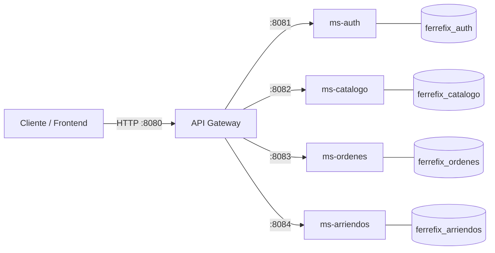
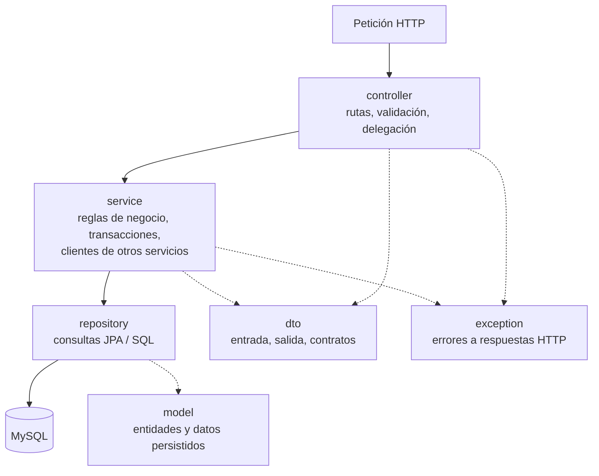
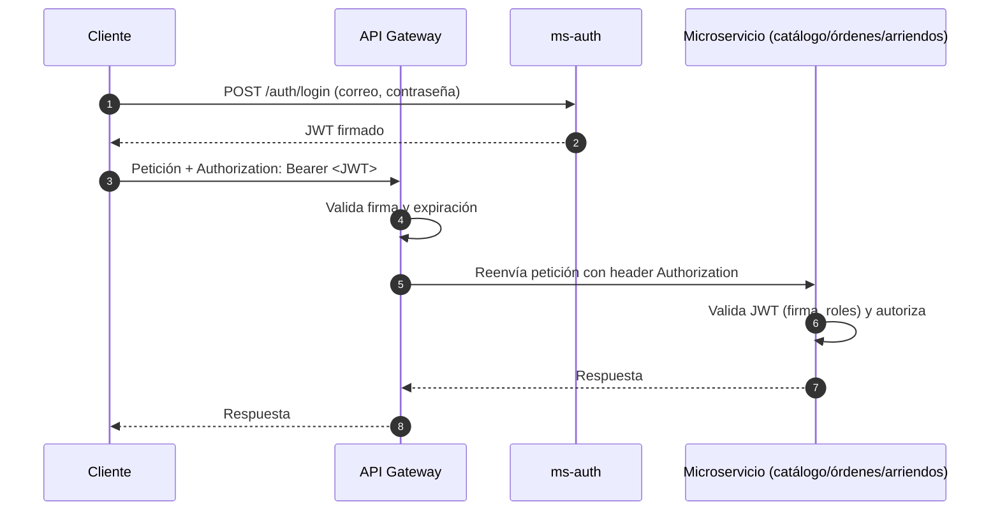

# Ferrefix Backend

Backend de Ferrefix, pensado para gestionar tanto la venta de productos de ferretería como el arriendo de maquinaria y resolver grandes necesidades de los usuarios del mundo ferretero. Está construido con Java 21 y Spring Boot 4.1.2 bajo una arquitectura de microservicios, donde cada módulo (usuarios, catálogo, pedidos y arriendos) corre aislado con su propia base de datos MySQL (Database per Service).

     

---

## Arquitectura

Ferrefix se compone de un **API Gateway** que expone un único punto de entrada y enruta hacia cuatro microservicios de negocio, cada uno con su propia base de datos MySQL aislada.



### Capas por servicio

Cada microservicio de negocio sigue la misma organización por capas. El gateway solo configura rutas y seguridad, sin dominio ni base de datos propia.



| Paquete | Responsabilidad |
| :--- | :--- |
| `model` | Modelo de Datos y declarativa de validaciones |
| `dto` | Datos y validaciones de entrada, respuestas y contratos entre servicios |
| `exception` | Conversión de errores a respuestas HTTP |
| `repository` | Consultas JPA o SQL y persistencia |
| `service` | Reglas de negocio, transacciones y clientes de otros servicios |
| `controller` | Rutas HTTP, validación y delegación al servicio |
| `config` | Seguridad, filtros, CORS, OpenAPI e inicialización |

---

## Servicios y puertos

| Servicio Compose | Contenedor | Puerto local | Base MySQL / puerto local |
| :--- | :--- | :--- | :--- |
| `api-gateway` | `ferrefix-gateway` | `8080` | — |
| `ms-auth` | `ferrefix-ms-auth` | `8081` | `ferrefix_auth` / `3306` |
| `ms-catalogo` | `ferrefix-ms-catalogo` | `8082` | `ferrefix_catalogo` / `3307` |
| `ms-ordenes` | `ferrefix-ms-ordenes` | `8083` | `ferrefix_ordenes` / `3308` |
| `ms-arriendos` | `ferrefix-ms-arriendos` | `8084` | `ferrefix_arriendos` / `3309` |

Los puertos publicados están ligados a `127.0.0.1` (localhost). Cada MySQL conserva su volumen y usuario propio.

---

## Seguridad: propagación de JWT

La autenticación usa correo y contraseña con sesiones JWT. El flujo de autenticación y Token Relay (propagación del token en los encabezados de las peticiones HTTP) es el siguiente:



**Puntos clave:**

- El gateway es el punto único de entrada: valida el JWT y propaga el header `Authorization` hacia el servicio destino.
- Cada microservicio vuelve a validar el token (firma y roles) antes de ejecutar la lógica de negocio. No confía ciegamente en el gateway.
- El `JWT_SECRET` se define en `.env` como Base64 de 32 bytes aleatorios y debe ser idéntico en todos los servicios que validan tokens.

---

## Prueba en Ejecución

### 1. Configurar `.env`

Completar las siguientes variables:

- `DB_PASSWORD`, `CATALOGO_DB_PASSWORD`, `ORDENES_DB_PASSWORD`, `ARRIENDOS_DB_PASSWORD`
- `MYSQL_ROOT_PASSWORD`
- `JWT_SECRET` (Base64 de 32 bytes aleatorios)
- `JWT_ACCESS_TOKEN_TTL` (opcional, `8h` por defecto; vigencia del token)
- `SEED_*` (contraseñas de las cuentas iniciales)

### 2. Generar los JAR

Con Java 21 instalado, sin ejecutar tests (DskipTests):

```powershell
.\empaquetar.bat
```

El script entra con `cd` en `auth`, `catalogo`, `ordenes`, `arriendos` y `gateway`, y ejecuta `call mvnw.cmd clean package` en cada uno con el objetivo de compilar el jar para el proceso de dockerización.

### 3. Levantar con Docker

En una instalación nueva, iniciar Docker y ejecutar:

```powershell
docker compose up --build -d
```

Cada `Dockerfile` usa `eclipse-temurin:21-jre` y copia el JAR de su propia carpeta `target`. Docker no compila Java: después de cambiar código, vuelve a generar el JAR antes de reconstruir la imagen.

### 4. Verificar

- **API:** `http://localhost:8080/api/v1`
- **Swagger:** `http://localhost:8080/swagger-ui/index.html`

---

## Almacenamiento multimedia

- **Estado actual:** Actualmente guardamos el contenido multimedia directamente en una carpeta media simulando un servicio de almacenamiento de objetos, no obstante esto no es óptimo como medidas de desarrollo seguro y escalable.
- **Roadmap:** está en evaluación migrar el contenido multimedia (imágenes, banners promocionales, videos y archivos) a un servicio de almacenamiento en la nube.

---

## Estructura del código

```text
ferrefix/
├── auth/            # ms-auth
├── catalogo/        # ms-catalogo
├── ordenes/         # ms-ordenes
├── arriendos/       # ms-arriendos
├── gateway/         # api-gateway
├── empaquetar.bat   # construcción
└── docker-compose.yml # orquestador
```

Microservicios: `application.properties`. Gateway: `application.yml`.